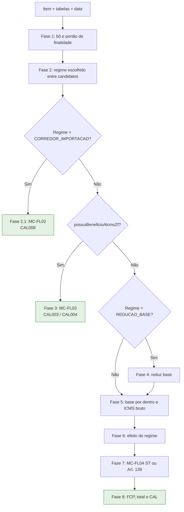
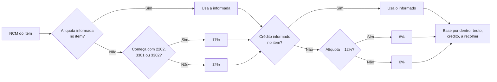
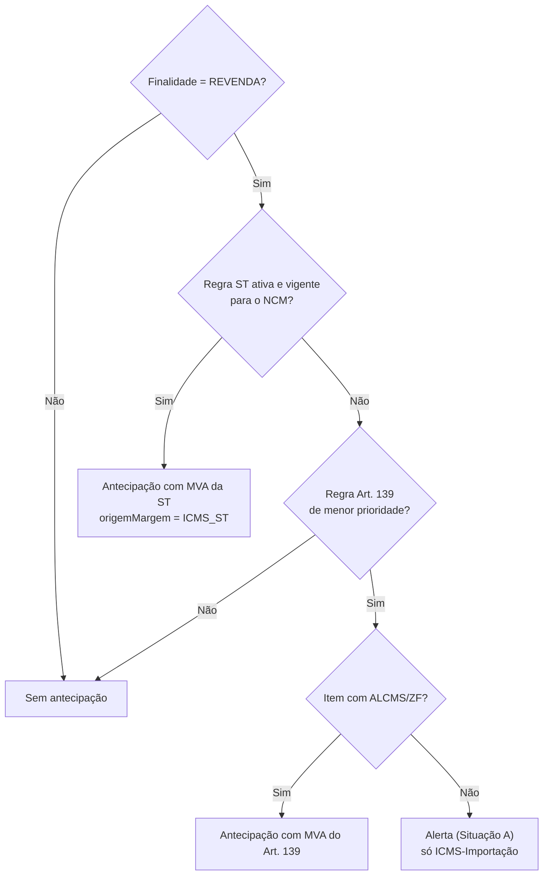
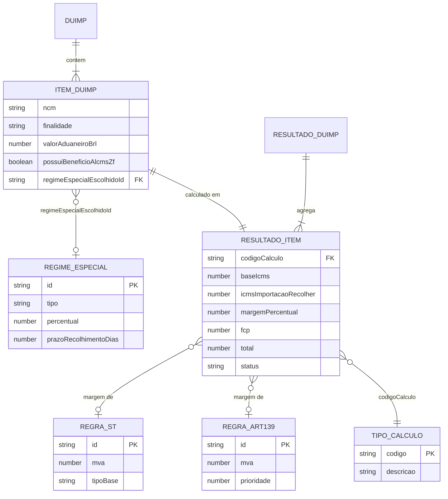

# Documento de Requisitos — SIMEX 1.0: Motor de Cálculo

| Item | Valor |
| --- | --- |
| Sistema | Sentinel Gov · SIMEX 1.0 |
| Fonte | [SIMEX1 — Manual das Tabelas](https://claude.ai/artifact/2ShnfAwh9r7ENjhDMJoTpU), seção **"Motor de Cálculo — Lógica Interna"** (versão de 11/09/2026) |
| Documento base | [SIMEX1 — Tabelas de Parâmetros e Motores de Cálculo](SIMEX1-tabelas-de-parametros.md) |
| Data deste documento | 23/10/2026 |
| Convenções | IDs deste documento usam o prefixo **MC-**. Referências ao documento base aparecem como **[Base: RF004]**. Itens marcados com **(inferido)** não estão explícitos na fonte |

Este documento detalha o requisito **[Base: RF004]** (cálculo por item) e o fluxo **[Base: FL02]**. Tabelas, atores e regras do documento base que o Motor de Cálculo usa são citados pelo ID original e não são repetidos. A relação completa está na seção 10.

---

## 1. Descrição geral

### 1.1 Objetivo

O Motor de Cálculo recebe os itens de uma DUIMP e as tabelas de parâmetros já carregadas. Para cada item, ele calcula a base do ICMS, o ICMS-Importação a recolher, o ICMS-Antecipação, o FCP e o total, e atribui o código de cálculo (CAL001–CAL008).

### 1.2 Identificação técnica

| Item | Valor |
| --- | --- |
| Arquivos | `web/lib/simex/calculate.ts` e `web/lib/simex/rules.ts` |
| Função de entrada | `calcularDuimp(duimp, itens, st, art, regimesEspeciais, modoTeste?)` |
| Funções auxiliares | `resolverRegimeEspecialEstadual()`, `buscarSt()`, `buscarArt139()`, `aliquotaAlcmsArt142()` |
| Saída | `ResultadoDuimp`, com valores e código CAL por item |
| Execução | No navegador (client-side) **[Base: RNF001]** |
| Uso | É o mesmo motor usado em produção na rota `/simex` |

### 1.3 Ordem oficial de decisão

Declarada no comentário de `calculate.ts`:

> finalidade → Corredor de Importação → benefício ALCMS/ZF → regime especial → ICMS-ST → Art. 139 → tipo de cálculo

Na execução, as fases são:

| Fase | Nome | Encerra o item? |
| --- | --- | --- |
| 1 | Base inicial e portão de finalidade | Não |
| 2 | Resolução do regime especial (escolha manual) | Não |
| 2.1 | Corredor de Importação | **Sim** (CAL008) |
| 3 | ALCMS/ZF | **Sim** (CAL003 / CAL004) |
| 4 | Redução de base | Não |
| 5 | ICMS bruto | Não |
| 6 | Efeito do regime especial | Não |
| 7 | ICMS-ST ou Art. 139 (antecipação) | Não |
| 8 | FCP, total e código CAL | Fim |

### 1.4 Escopo

| Dentro do escopo | Fora do escopo |
| --- | --- |
| Cálculo de um item da DUIMP, da base inicial ao total | Carga das tabelas **[Base: RF001]** |
| Aplicação do regime escolhido pelo analista | Lista de candidatos **[Base: RF002]** |
| Corredor, ALCMS/ZF, efeitos de regime, ST, Art. 139, FCP | Discriminação da guia e DAR **[Base: RF007, RF008]** |
| Atribuição do código CAL | Gravação da malha **[Base: RF010]** |
| Alertas gerados no cálculo | Alíquotas internas em rascunho **[Base: RF025]** |

### 1.5 Glossário complementar

O glossário completo está no documento base (seção 1.4).

| Termo | Significado |
| --- | --- |
| b0 | Base inicial do item (soma dos tributos federais e despesas) |
| Base "por dentro" | Base em que o próprio ICMS faz parte do valor: base ÷ (1 − alíquota) |
| `usoSemRevenda` | Indicador de que a finalidade do item não é REVENDA |
| `codigoUso` | Código CAL fixado pela finalidade (CAL005, CAL006 ou CAL007) |
| Situação A | Item sem ALCMS e sem ST: recolhe apenas o ICMS-Importação |
| Situação B | Item sem ALCMS com ST: calcula a antecipação pela regra ST |
| REGRA 01 / REGRA 06 | Nomes usados na fonte para as Situações B e A, respectivamente |

---

## 2. Atores

| Ator | Tipo | Papel no Motor de Cálculo | Base |
| --- | --- | --- | --- |
| Analista fiscal | Humano | Escolhe o regime do item (`regimeEspecialEscolhidoId`) e consulta o resultado e o memorial | Atores, RF003 |
| Motor de Cálculo | Sistema | Executa as fases 1 a 8 para cada item | RF004 |
| Motor de Regras | Sistema | Fornece os candidatos de onde sai o regime escolhido | RF002 |
| ADM / Gestora | Humano | Mantém as tabelas T1, T2 e T3 que o motor lê | RF014–RF017 |
| Desenvolvedor | Humano | Cria fórmulas (códigos CAL) novas, únicas mudanças que exigem código | RNF002 |
| PCCE | Sistema | Recebe o resultado; dispara a malha do Corredor | FL01, FL07 |
| Auditor | Humano | Acompanha a malha MAL-SIMEX-008 gerada a partir do CAL008 | RF013 |

---

## 3. Requisitos funcionais

| ID | Descrição | Prioridade | Ator | Base |
| --- | --- | --- | --- | --- |
| MC-RF01 | Calcular a base inicial b0 de cada item | Alta | Motor de Cálculo | RF004 |
| MC-RF02 | Definir o indicador `usoSemRevenda` e o `codigoUso` pela finalidade | Alta | Motor de Cálculo | RF004 |
| MC-RF03 | Resolver o regime especial do item somente a partir da escolha manual do analista | Alta | Motor de Cálculo / Analista | RF003 |
| MC-RF04 | Tratar o Corredor de Importação: calcular o ICMS diferido, o prazo e encerrar o item com CAL008 | Alta | Motor de Cálculo | RF004, RF009, RF010 |
| MC-RF05 | Tratar itens com ALCMS/ZF: definir alíquota do art. 142, crédito presumido e encerrar com CAL003 ou CAL004 | Alta | Motor de Cálculo | RF004 |
| MC-RF06 | Aplicar a redução de base quando o regime for REDUCAO_BASE | Média | Motor de Cálculo | RF004 |
| MC-RF07 | Calcular a base do ICMS por dentro e o ICMS bruto | Alta | Motor de Cálculo | RF004 |
| MC-RF08 | Aplicar o efeito do regime especial sobre o ICMS bruto | Alta | Motor de Cálculo | RF004 |
| MC-RF09 | Buscar a regra ICMS-ST e, na ausência dela, a regra Art. 139, respeitando o portão de finalidade | Alta | Motor de Cálculo | RF005, RF006 |
| MC-RF10 | Calcular o ICMS-Antecipação com a margem (MVA) da regra encontrada | Alta | Motor de Cálculo | RF005, RF006 |
| MC-RF11 | Calcular o FCP e o total do item | Alta | Motor de Cálculo | RF004 |
| MC-RF12 | Atribuir o código de cálculo (CAL001–CAL008) | Alta | Motor de Cálculo | RF004 |
| MC-RF13 | Registrar alertas do cálculo (prazo de diferimento, Art. 139 sem ALCMS) | Média | Motor de Cálculo | RF004, RF026 |
| MC-RF14 | Montar o `ResultadoDuimp` com valores, status, origem da margem e fundamento legal por item | Alta | Motor de Cálculo | RF026 |
| MC-RF15 | Exibir ao analista o resultado e o memorial de cálculo de cada item | Média | Analista | RF026 |

## 4. Requisitos não funcionais

| ID | Categoria | Descrição | Base |
| --- | --- | --- | --- |
| MC-RNF01 | Arquitetura | O motor é uma função pura sobre os arrays recebidos; não faz chamadas de rede próprias | RNF001 |
| MC-RNF02 | Consistência | O mesmo motor atende a análise do SIMEX1 e a rota de produção `/simex` | — |
| MC-RNF03 | Determinismo | Mesmos itens, tabelas e data de análise produzem o mesmo resultado **(inferido)** | — |
| MC-RNF04 | Ordem | As fases seguem a sequência fixa da seção 1.3; uma fase que encerra o item impede as seguintes | — |
| MC-RNF05 | Manutenibilidade | Regras fiscais entram por cadastro nas tabelas; código novo só para fórmula CAL nova | RNF002 |
| MC-RNF06 | Rastreabilidade | Cada valor calculado indica a regra e o fundamento legal usados | RNF004 |
| MC-RNF07 | Precisão | Valores monetários em reais (sufixo `Brl`); regra de arredondamento a definir (seção 9) | — |
| MC-RNF08 | Testabilidade | A função aceita o parâmetro `modoTeste`; seu comportamento deve ser documentado (seção 9) | — |

---

## 5. Regras de negócio

| ID | Regra | Requisitos | Base |
| --- | --- | --- | --- |
| MC-RN01 | **Base inicial:** b0 = `valorAduaneiroBrl` + `valorIiBrl` + `valorIpiBrl` + `valorPisBrl` + `valorCofinsBrl` + `despesasAduaneirasBrl` + `outrosAcrescimosBrl` (Art. 138, I, Lei 400/1997). | MC-RF01 | RN004 |
| MC-RN02 | **Portão de finalidade:** `usoSemRevenda` = finalidade diferente de REVENDA. Quando verdadeiro, ST e Art. 139 não são buscados e não há antecipação. | MC-RF02, MC-RF09 | RN005 |
| MC-RN03 | **Código por finalidade:** USO_CONSUMO → CAL005; ATIVO_IMOBILIZADO → CAL006; INSTALACAO_INDUSTRIAL → CAL007; demais → sem `codigoUso`. O `codigoUso` prevalece sobre CAL001–CAL004. | MC-RF02, MC-RF12 | RN005, RN017 |
| MC-RN04 | **Correção de 25/08/2026:** INDUSTRIALIZACAO não gera antecipação. Antes, só as três finalidades de uso bloqueavam a antecipação. | MC-RF02 | RN005 |
| MC-RN05 | **Regime só por escolha manual:** sem `regimeEspecialEscolhidoId`, o item não tem regime. Com ele, o regime é procurado **entre os candidatos** do item; se não estiver entre eles, o item fica sem regime. | MC-RF03 | RN001, RN002 |
| MC-RN06 | **Corredor encerra o item:** se o regime for CORREDOR_IMPORTACAO, baseIcmsCorredor = b0 ÷ (1 − alíquota do Corredor); ICMS diferido = baseIcmsCorredor × alíquota do Corredor; ICMS a recolher = 0; status `ICMS_DIFERIDO`; código CAL008. As fases 3 a 8 não são executadas. A base serve só de referência e para a GLME. | MC-RF04 | RN006 |
| MC-RN07 | **Prazo do Corredor no cálculo:** `prazoRecolhimentoDias` do Ato quando maior que 0; senão 60 dias. O cálculo gera alerta de prazo e o item passa a ser monitorado pela MAL-SIMEX-008. | MC-RF04, MC-RF13 | RN007, RN023 |
| MC-RN08 | **Gatilho ALCMS:** a fase 3 é executada quando `possuiBeneficioAlcmsZf` é verdadeiro no item. O motor não deduz o benefício pelo NCM. | MC-RF05 | RN009, RN033 |
| MC-RN09 | **Alíquota ALCMS (art. 142, Lei 400/1997):** NCM iniciado por 2202 (refrigerantes) → 17%; iniciado por 3301 ou 3302 (perfumaria/cosméticos) → 17%; demais → 12%. O NCM é comparado só pelos dígitos. `aliquotaIcmsImportacaoAlcms` informado no item substitui esse valor. | MC-RF05 | RN009 |
| MC-RN10 | **Crédito presumido ALCMS (art. 137-A, §1º, Lei 2.217/2017):** 8% automático quando a alíquota é 12%; 0% nos demais casos. `percentualCreditoPresumidoAlcms` informado no item substitui esse valor. | MC-RF05 | RN010 |
| MC-RN11 | **Cálculo ALCMS:** baseIcms = b0 ÷ (1 − alíquota); icmsBruto = baseIcms × alíquota; crédito = baseIcms × % crédito; ICMS a recolher = icmsBruto − crédito. O item encerra com CAL004 (há regra ST) ou CAL003 (não há), salvo `codigoUso`. | MC-RF05, MC-RF12 | RN009–RN011, RN017 |
| MC-RN12 | **Redução de base:** com regime REDUCAO_BASE, a base tributável é reduzida antes do ICMS bruto. O cálculo exato da redução não consta da fonte (seção 9). | MC-RF06 | RN012 |
| MC-RN13 | **ICMS por dentro:** baseIcms = base tributável ÷ (1 − alíquota); icmsBruto = baseIcms × alíquota. A alíquota é a do item da DUIMP, não a `aliquotaInterna` da regra ST. | MC-RF07 | RN011 |
| MC-RN14 | **Efeitos do regime:** DISPENSA_INTEGRAL → ICMS 0; REDUCAO_IMPOSTO → icmsBruto × (1 − percentual); CREDITO_PRESUMIDO → icmsBruto − baseIcms × percentual; DIFERIMENTO → ICMS 0, status `ICMS_DIFERIDO` e alerta de prazo; SUSPENSAO → ICMS 0, status `SUSPENSO_SOB_CONDICAO`. | MC-RF08, MC-RF13 | RN012 |
| MC-RN15 | **Busca ST:** só quando `usoSemRevenda` é falso. Usa a primeira regra ativa, vigente e com NCM do item iniciado por um item de `ncms`, sem ordenação. | MC-RF09 | RN014 |
| MC-RN16 | **Busca Art. 139:** só quando `usoSemRevenda` é falso **e** não há regra ST. Considera regras ativas, vigentes, com `prefixosNcm` vazio ou casando com o NCM, e usa a de menor `prioridade`. | MC-RF09 | RN013, RN015 |
| MC-RN17 | **ST prevalece:** havendo regra ST, o Art. 139 não é consultado. | MC-RF09 | RN013 |
| MC-RN18 | **Situação B (REGRA 01):** item sem ALCMS e com regra ST calcula antecipação normalmente. | MC-RF10 | RN016 |
| MC-RN19 | **Situação A (REGRA 06):** sem ALCMS o Art. 139 nunca é aplicado. Se o NCM se enquadraria no Art. 139, o motor registra alerta e recolhe somente o ICMS-Importação. | MC-RF10, MC-RF13 | RN016 |
| MC-RN20 | **Margem da antecipação:** usa o `mva` da regra ST (com `origemMargem = ICMS_ST`) ou da regra Art. 139. A fórmula da antecipação não consta da fonte (seção 9). | MC-RF10, MC-RF14 | RN014, RN015 |
| MC-RN21 | **Regras Art. 139 padrão:** ART139-B (prioridade 5, NCM 2202/2203, MVA 140%); ART139-A (prioridade 10, NCM 2204–2208 e 2401–2403, MVA 50%); ART139-C (prioridade 10, NCM 3301/3302, MVA 30%); ART139-E (prioridade 999, todos, MVA 15%). | MC-RF09 | Base 8.3 |
| MC-RN22 | **FCP e total:** fcp = baseIcms × alíquota de FCP; total = ICMS + antecipação + FCP. | MC-RF11 | RN018 |
| MC-RN23 | **Código CAL sem ALCMS:** `codigoUso`, senão CAL002 (há ST), senão CAL001. **Com ALCMS:** `codigoUso`, senão CAL004 (há ST), senão CAL003. **Corredor:** CAL008. | MC-RF12 | RN017 |
| MC-RN24 | **Motores desligados:** com a chave `regrasSt` desligada, a busca ST não é aplicada; com `art139` desligada, a busca Art. 139 não é aplicada. | MC-RF09 | RN034 |

---

## 6. Fluxos

### 6.1 MC-FL01 — Cálculo de um item (fluxo principal)

Detalha **[Base: FL02]**.

1. O motor recebe o item, as tabelas e a data da análise.
2. Calcula b0 (MC-RN01).
3. Define `usoSemRevenda` e `codigoUso` (MC-RN02, MC-RN03).
4. Resolve o regime escolhido (MC-RN05).
5. Se o regime é Corredor, executa o MC-FL02 e encerra.
6. Se o item tem ALCMS/ZF, executa o MC-FL03 e encerra.
7. Se o regime é REDUCAO_BASE, reduz a base (MC-RN12).
8. Calcula a base por dentro e o ICMS bruto (MC-RN13).
9. Aplica o efeito do regime (MC-RN14).
10. Executa o MC-FL04 (ST ou Art. 139).
11. Calcula FCP e total (MC-RN22).
12. Atribui o código CAL (MC-RN23) e devolve o resultado do item.

**Fluxos alternativos**

- **A1 — Sem regime escolhido:** o passo 4 retorna vazio; os passos 7 e 9 não alteram valores.
- **A2 — Regime escolhido deixou de ser candidato** (por exemplo, venceu ou foi suspenso entre a escolha e o cálculo): o item é calculado sem regime (MC-RN05).
- **A3 — Finalidade diferente de REVENDA:** o passo 10 não busca regras; não há antecipação.



### 6.2 MC-FL02 — Corredor de Importação

1. Obtém a alíquota do Corredor **(origem a confirmar, seção 9)**.
2. Calcula baseIcmsCorredor e o ICMS diferido (MC-RN06).
3. Define o prazo: `prazoRecolhimentoDias` do Ato ou 60 dias (MC-RN07).
4. Devolve CAL008, ICMS a recolher 0 e status `ICMS_DIFERIDO`.
5. Registra o alerta de prazo.
6. Após o retorno ao PCCE, a malha MAL-SIMEX-008 é montada **[Base: FL07]**.

### 6.3 MC-FL03 — ALCMS/ZF

1. Define a alíquota pelo NCM (MC-RN09) ou usa a informada no item.
2. Define o percentual de crédito presumido (MC-RN10) ou usa o informado.
3. Calcula baseIcms, ICMS bruto, crédito e ICMS a recolher (MC-RN11).
4. Atribui CAL004 se houver regra ST para o NCM, senão CAL003, salvo `codigoUso`.



### 6.4 MC-FL04 — ICMS-ST e Art. 139

1. Se `usoSemRevenda` é verdadeiro, não há antecipação; segue para a fase 8.
2. Busca a regra ST (MC-RN15). Se encontrar, calcula a antecipação com o MVA da ST (`origemMargem = ICMS_ST`).
3. Sem regra ST, busca a regra Art. 139 (MC-RN16).
4. Se encontrar regra Art. 139 e o item não tiver ALCMS, registra alerta e não calcula antecipação (MC-RN19).

**Exceção E1 — Duas regras ST para o mesmo NCM:** o motor usa a primeira encontrada; não há critério de desempate (seção 9).



> O passo E "Item com ALCMS/ZF? → Sim" só é alcançável se a fase 3 não encerrar o item. Ver a inconsistência registrada na seção 9.

### 6.5 MC-FL05 — Atribuição do código de cálculo

| Corredor | ALCMS/ZF | Finalidade | Regra ST | Código |
| --- | --- | --- | --- | --- |
| Sim | — | — | — | CAL008 |
| Não | — | USO_CONSUMO | — | CAL005 |
| Não | — | ATIVO_IMOBILIZADO | — | CAL006 |
| Não | — | INSTALACAO_INDUSTRIAL | — | CAL007 |
| Não | Não | REVENDA ou INDUSTRIALIZACAO | Não | CAL001 |
| Não | Não | REVENDA ou INDUSTRIALIZACAO | Sim | CAL002 |
| Não | Sim | REVENDA ou INDUSTRIALIZACAO | Não | CAL003 |
| Não | Sim | REVENDA ou INDUSTRIALIZACAO | Sim | CAL004 |

> A linha de INDUSTRIALIZACAO com regra ST "Sim" segue a fórmula da fonte (`regraSt ? CAL002`). Como a busca ST não ocorre para essa finalidade, na prática o código fica CAL001/CAL003 (ver seção 9).

### 6.6 MC-FL06 — Consulta do resultado pelo analista

Relacionado a **[Base: FL01, passo 5]** e **[Base: TL06]**.

1. O analista conclui a escolha de regimes na análise da DUIMP.
2. O sistema executa `calcularDuimp` para todos os itens.
3. O sistema exibe o resultado por item e o total da DUIMP.
4. O analista abre o memorial de um item para ver fases, regras e fundamentos.
5. Se alterar a escolha de regime, o cálculo é refeito **(inferido)**.

---

## 7. Elementos de tela

> A fonte não descreve layout. As telas abaixo detalham o que **[Base: TL06]** mostra sobre o cálculo. Os tipos de componente são **(inferido)**; nomes de campo e valores vêm da fonte.

### 7.1 MC-TL01 — Dados do item usados no cálculo (somente leitura na análise)

| Campo | Tipo | Obrigatório | Validação / Máscara | Regra |
| --- | --- | --- | --- | --- |
| NCM | Texto | Sim | Só dígitos na comparação | MC-RN09, MC-RN15, MC-RN16 |
| Finalidade | Texto | Sim | REVENDA, INDUSTRIALIZACAO, USO_CONSUMO, ATIVO_IMOBILIZADO, INSTALACAO_INDUSTRIAL | MC-RN02, MC-RN03 |
| Modalidade de importação | Texto | Não | CONTA_PROPRIA, CONTA_E_ORDEM, ENCOMENDA | [Base: RN002] |
| Valor aduaneiro (R$) | Moeda | Sim | ≥ 0 | MC-RN01 |
| II, IPI, PIS, COFINS (R$) | Moeda | Sim | ≥ 0 | MC-RN01 |
| Despesas aduaneiras (R$) | Moeda | Sim | ≥ 0 | MC-RN01 |
| Outros acréscimos (R$) | Moeda | Sim | ≥ 0 | MC-RN01 |
| Alíquota de ICMS (%) | Percentual | Sim | 0 a 100 | MC-RN13 |
| Alíquota de FCP (%) | Percentual | Não | 0 a 100 | MC-RN22 |
| Possui benefício ALCMS/ZF | Indicador | Sim | Sim/Não | MC-RN08 |
| Alíquota ALCMS informada (%) | Percentual | Não | Substitui a do art. 142 | MC-RN09 |
| Crédito presumido ALCMS informado (%) | Percentual | Não | Substitui o padrão | MC-RN10 |

### 7.2 MC-TL02 — Seleção de regime do item (Analista)

| Campo | Tipo | Obrigatório | Validação / Máscara | Regra |
| --- | --- | --- | --- | --- |
| Regime especial | Select | Não | Só candidatos do item **[Base: RF002]** | MC-RN05 |
| Tipo e percentual do regime escolhido | Texto | — | Somente leitura | MC-RN14 |
| Botão "Recalcular" | Botão | — | Executa o cálculo de novo **(inferido)** | MC-RF15 |

### 7.3 MC-TL03 — Resultado do cálculo por item

| Campo | Tipo | Obrigatório | Validação / Máscara | Regra |
| --- | --- | --- | --- | --- |
| Código de cálculo | Badge | — | CAL001–CAL008 com descrição | MC-RN23 |
| Base inicial b0 (R$) | Moeda | — | — | MC-RN01 |
| Base do ICMS (R$) | Moeda | — | — | MC-RN13 |
| ICMS bruto (R$) | Moeda | — | — | MC-RN13 |
| Crédito presumido (R$) | Moeda | — | Só quando houver | MC-RN11, MC-RN14 |
| ICMS a recolher (R$) | Moeda | — | — | MC-RN14 |
| ICMS diferido (R$) | Moeda | — | Só Corredor ou Diferimento | MC-RN06, MC-RN14 |
| Antecipação (R$) | Moeda | — | — | MC-RN20 |
| Origem da margem | Texto | — | Ex.: ICMS_ST | MC-RN20 |
| Margem (%) | Percentual | — | MVA da regra usada | MC-RN20 |
| FCP (R$) | Moeda | — | — | MC-RN22 |
| Total (R$) | Moeda | — | ICMS + antecipação + FCP | MC-RN22 |
| Status | Badge | — | ICMS_DIFERIDO, SUSPENSO_SOB_CONDICAO ou vazio | MC-RN06, MC-RN14 |

### 7.4 MC-TL04 — Memorial e alertas do item

| Campo | Tipo | Obrigatório | Validação / Máscara | Regra |
| --- | --- | --- | --- | --- |
| Fases executadas | Lista ordenada | — | Fases 1 a 8, indicando onde o item encerrou | MC-RNF04 |
| Regra ST ou Art. 139 usada | Texto com link | — | Id, código e fundamento legal | MC-RN15, MC-RN16 |
| Regime aplicado | Texto | — | Ato Declaratório e legislação | MC-RN05 |
| Alerta de prazo | Alerta | — | Prazo em dias e data limite **(inferido)** | MC-RN07, MC-RN14 |
| Alerta Art. 139 sem ALCMS | Alerta | — | Texto da Situação A | MC-RN19 |

---

## 8. Base de dados

O Motor de Cálculo **lê** tabelas do Firestore e **produz** um resultado em memória. A fonte não informa se o resultado é gravado; a gravação da malha é responsabilidade de quem chama **[Base: RN024]**.

### 8.1 Tabelas lidas

| Coleção | Uso no Motor de Cálculo | Campos lidos | Base |
| --- | --- | --- | --- |
| `simex_regimes_especiais` | Regime escolhido, tipo, percentual e prazo | id, tipo, percentual, prazoRecolhimentoDias, legislacao | 8.1 |
| `simex_regras_st` (via `simex_catalogo_itens_segmento`) | Busca ST | ncms, mva, tipoBase, valorPauta, ativo, vigência, fundamentoLegal | 8.2 |
| `simex_regras_art139` | Busca Art. 139 | prefixosNcm, mva, prioridade, ativo, vigência, fundamentoLegal | 8.3 |
| `simex_config/status_motores` | Chaves regrasSt e art139 | regrasSt, art139 | 7.8, RN034 |
| `simex_tipos_calculo` | Descrição dos códigos CAL na tela | código, descrição | 8.5 |

### 8.2 Entrada — Item da DUIMP (campos usados)

| Coluna | Tipo | PK/FK | Nulo | Descrição |
| --- | --- | --- | --- | --- |
| id do item | string | PK **(inferido)** | Não | Identificação do item na DUIMP |
| ncm | string | — | Não | NCM do produto |
| finalidade | enum | — | Não | Finalidade tributária |
| modalidadeImportacao | enum | — | Sim | Modalidade de importação |
| valorAduaneiroBrl | number | — | Não | Valor aduaneiro em R$ |
| valorIiBrl | number | — | Não | Imposto de Importação |
| valorIpiBrl | number | — | Não | IPI |
| valorPisBrl | number | — | Não | PIS |
| valorCofinsBrl | number | — | Não | COFINS |
| despesasAduaneirasBrl | number | — | Não | Despesas aduaneiras |
| outrosAcrescimosBrl | number | — | Não | Outros acréscimos |
| aliquota de ICMS | number | — | Não | Alíquota do item **(nome do campo não informado)** |
| aliquotaFcp | number | — | Sim | Alíquota de FCP **(nome inferido)** |
| possuiBeneficioAlcmsZf | boolean | — | Não | Item com benefício ALCMS/ZF |
| aliquotaIcmsImportacaoAlcms | number | — | Sim | Alíquota ALCMS informada |
| percentualCreditoPresumidoAlcms | number | — | Sim | Crédito presumido informado |
| regimeEspecialEscolhidoId | string | FK → `simex_regimes_especiais.id` | Sim | Regime escolhido pelo analista |

### 8.3 Saída — Resultado do item (`ResultadoDuimp`)

| Coluna | Tipo | PK/FK | Nulo | Descrição |
| --- | --- | --- | --- | --- |
| id do item | string | FK → Item da DUIMP **(inferido)** | Não | Item calculado |
| codigoCalculo | string | FK → `simex_tipos_calculo` | Não | CAL001–CAL008 |
| baseIcms | number | — | Sim | Base por dentro |
| icmsBruto | number | — | Sim | ICMS antes do regime |
| creditoPresumido | number | — | Sim | Crédito ALCMS ou do regime **(nome inferido)** |
| icmsImportacaoRecolher | number | — | Não | ICMS a recolher |
| valorIcmsDiferido | number | — | Sim | ICMS diferido (Corredor) |
| prazoDias | number | — | Sim | Prazo do diferimento |
| status | string | — | Sim | ICMS_DIFERIDO, SUSPENSO_SOB_CONDICAO |
| antecipacao | number | — | Sim | ICMS-Antecipação **(nome inferido)** |
| origemMargem | string | — | Sim | Ex.: ICMS_ST |
| margemPercentual | number | — | Sim | MVA usado |
| fcp | number | — | Sim | FCP |
| total | number | — | Não | ICMS + antecipação + FCP |
| alertas | lista | — | Sim | Alertas do item **(inferido)** |

### 8.4 Diagrama de entidades



---

## 9. Pontos em aberto e premissas

- [ ] **Ordem declarada × fases executadas:** o comentário põe ALCMS antes do regime especial, mas o regime é resolvido na fase 2 e seus efeitos só valem na fase 6, que não é executada para itens ALCMS. Um item ALCMS com regime DISPENSA_INTEGRAL, por exemplo, tem ICMS zerado ou não?
- [ ] **ST no ramo ALCMS:** a fase 3 "encerra" o item, mas o código depende de haver regra ST (CAL004). A antecipação de itens ALCMS é calculada? O Art. 139, que exige ALCMS, só faz sentido se for.
- [ ] **Corredor × finalidade:** o texto diz que CAL005/006/007 valem "independentemente de qualquer outra regra", mas o Corredor encerra o item com CAL008 antes. Qual código vale para um item de uso e consumo com Corredor?
- [ ] **Alíquota do Corredor:** a origem de `aliqCorredor` não é informada (percentual do Ato? 4% ou 1% pelo decreto?). Ver também [Base: seção 11, percentual do Corredor].
- [ ] **Prazo do Corredor:** o cálculo usa "Ato ou 60 dias", sem consultar `prazoPadraoDias` da tabela de vencimento, que o Motor 3 usa como segunda opção [Base: RN007]. As duas regras devem ser iguais?
- [ ] **Fórmula da antecipação:** a fonte não descreve o cálculo com MVA, nem as fórmulas para `tipoBase` PAUTA e PMC. Uma fórmula comum é base × (1 + MVA) × alíquota interna − ICMS da operação **(inferido, a confirmar)**.
- [ ] **Redução de base:** como o percentual de REDUCAO_BASE é aplicado (sobre b0? sobre a base tributável?).
- [ ] **CAL002 para INDUSTRIALIZACAO:** a fórmula permite CAL002, mas a busca ST não ocorre para essa finalidade. Confirmar se o código deve ser CAL001.
- [ ] **Desempate de regras ST:** sem ordenação; ver [Base: seção 11].
- [ ] **Arredondamento:** em que fase e com quantas casas os valores são arredondados.
- [ ] **Parâmetro `modoTeste`:** o que muda no cálculo quando é usado.
- [ ] **Alertas:** texto, gravidade e destino dos alertas de prazo e da Situação A.
- [ ] **Status de itens comuns:** a fonte só define status para diferimento, Corredor e suspensão.
- [ ] **Telas e nomes de campo:** os itens marcados como (inferido) nas seções 7 e 8 precisam de confirmação.

---

## 10. Relação com o documento base

| Este documento | Documento base | Relação |
| --- | --- | --- |
| Seção 1 | 1.1–1.4, RF004 | Detalha o RF004 e o glossário |
| Atores (seção 2) | Seção 2 | Reusa Analista, ADM, Desenvolvedor, PCCE, Auditor |
| MC-RF01, MC-RF07, MC-RF11 | RF004 | Base, ICMS bruto, FCP e total |
| MC-RF02 | RF004, RN005 | Portão de finalidade |
| MC-RF03 | RF003, RN001, RN002 | Escolha manual entre candidatos |
| MC-RF04 | RF004, RF009, RF010, RN006, RN007 | Corredor e prazo |
| MC-RF05 | RF004, RN009, RN010 | ALCMS/ZF |
| MC-RF06, MC-RF08 | RN012 | Efeitos do regime |
| MC-RF09, MC-RF10 | RF005, RF006, RN013–RN016 | ST e Art. 139 |
| MC-RF12 | RN017, seção 9 (códigos CAL) | Código de cálculo |
| MC-RF13–MC-RF15 | RF026 | Memorial e alertas |
| MC-RN24 | RN034, TL08 | Chaves do painel de motores |
| MC-FL01 | FL02 | Detalhamento |
| MC-FL02 | FL07 | Origem da malha MAL-SIMEX-008 |
| MC-FL06 | FL01 | Etapa de cálculo da análise |
| MC-TL01–MC-TL04 | TL06 | Detalhamento da tela de análise |
| Seção 8.1 | 8.1–8.5 | Mesmas coleções, só campos lidos |
| Seção 9 | Seção 11 | Pontos complementares |
| Critérios MC-CA | CA-RF003–CA-RF006 | Mesmos cenários com valores calculados |

---

## 11. Critérios de aceite

Formato **Dado / Quando / Então**. Valores monetários arredondados a 2 casas no exemplo. Critérios que dependem da seção 9 estão marcados com **(depende de validação)**.

### MC-CA01 — Base inicial (MC-RF01)

```gherkin
Cenário: Soma dos componentes
  Dado um item com valor aduaneiro R$ 10.000,00, II R$ 1.400,00, IPI R$ 1.000,00,
    PIS R$ 210,00, COFINS R$ 965,00, despesas R$ 300,00 e outros acréscimos R$ 125,00
  Quando o Motor de Cálculo processa o item
  Então b0 é R$ 14.000,00
```

### MC-CA02 — Portão de finalidade e código (MC-RF02, MC-RF12)

```gherkin
Esquema do Cenário: Finalidade bloqueia antecipação
  Dado um item sem ALCMS, sem regime, com finalidade <finalidade>
  E NCM "87089990" coberto pela regra ST com MVA 71,78
  Quando o Motor de Cálculo processa o item
  Então a antecipação é <antecipacao>
  E o código é <codigo>

  Exemplos:
    | finalidade            | antecipacao | codigo |
    | REVENDA               | calculada   | CAL002 |
    | INDUSTRIALIZACAO      | 0           | CAL001 |
    | USO_CONSUMO           | 0           | CAL005 |
    | ATIVO_IMOBILIZADO     | 0           | CAL006 |
    | INSTALACAO_INDUSTRIAL | 0           | CAL007 |
```

> A linha INDUSTRIALIZACAO → CAL001 depende da confirmação do ponto "CAL002 para INDUSTRIALIZACAO" da seção 9.

### MC-CA03 — Regime por escolha manual (MC-RF03)

```gherkin
Cenário: Sem escolha, sem regime
  Dado um item com candidato DISPENSA_INTEGRAL e regimeEspecialEscolhidoId vazio
  Quando o Motor de Cálculo processa o item
  Então o ICMS a recolher é igual ao ICMS bruto

Cenário: Escolhido fora dos candidatos
  Dado um item com regimeEspecialEscolhidoId de um regime que foi SUSPENSO após a escolha
  Quando o Motor de Cálculo processa o item
  Então o item é calculado sem regime
```

### MC-CA04 — Corredor de Importação (MC-RF04)

```gherkin
Cenário: Cálculo do diferimento
  Dado um item com b0 R$ 10.000,00, regime CORREDOR_IMPORTACAO escolhido e alíquota do Corredor 4%
  Quando o Motor de Cálculo processa o item
  Então a base do Corredor é R$ 10.416,67
  E o ICMS diferido é R$ 416,67
  E o ICMS a recolher é 0
  E o status é ICMS_DIFERIDO
  E o código é CAL008
  E as fases 3 a 8 não são executadas

Esquema do Cenário: Prazo do Corredor
  Dado um Ato com prazoRecolhimentoDias <prazoAto>
  Quando o Motor de Cálculo processa um item com esse Corredor
  Então o prazo do alerta é <prazo> dias

  Exemplos:
    | prazoAto | prazo |
    | 90       | 90    |
    | 0        | 60    |
    | vazio    | 60    |

Cenário: Corredor com finalidade de uso (depende de validação)
  Dado um item USO_CONSUMO com regime CORREDOR_IMPORTACAO escolhido
  Quando o Motor de Cálculo processa o item
  Então o código segue a decisão registrada na seção 9
```

### MC-CA05 — ALCMS/ZF (MC-RF05)

```gherkin
Esquema do Cenário: Alíquota e crédito padrão
  Dado um item REVENDA sem regime, com possuiBeneficioAlcmsZf verdadeiro, b0 R$ 10.000,00 e NCM <ncm>
  E sem regra ST para o NCM
  Quando o Motor de Cálculo processa o item
  Então a alíquota é <aliq>, a base do ICMS é <base>, o ICMS bruto é <bruto>
  E o crédito é <credito> e o ICMS a recolher é <recolher>
  E o código é CAL003

  Exemplos:
    | ncm      | aliq | base      | bruto    | credito | recolher |
    | 96032900 | 12%  | 11.363,64 | 1.363,64 | 909,09  | 454,55   |
    | 22021000 | 17%  | 12.048,19 | 2.048,19 | 0,00    | 2.048,19 |
    | 33021000 | 17%  | 12.048,19 | 2.048,19 | 0,00    | 2.048,19 |

Cenário: Valores informados no item prevalecem
  Dado um item ALCMS com NCM "96032900", aliquotaIcmsImportacaoAlcms 7 e percentualCreditoPresumidoAlcms 2
  Quando o Motor de Cálculo processa o item
  Então a alíquota usada é 7% e o crédito é 2% da base do ICMS

Cenário: ALCMS com ST
  Dado um item ALCMS REVENDA cujo NCM tem regra ST ativa
  Quando o Motor de Cálculo processa o item
  Então o código é CAL004

Cenário: ALCMS não é deduzido do NCM
  Dado um item com possuiBeneficioAlcmsZf falso e NCM elegível na Consulta NCM
  Quando o Motor de Cálculo processa o item
  Então a fase 3 não é executada
```

### MC-CA06 — ICMS bruto e efeitos do regime (MC-RF06 a MC-RF08)

Para os cenários abaixo: item sem ALCMS, finalidade REVENDA, sem regra ST ou Art. 139, b0 R$ 14.000,00 e alíquota 18%.

```gherkin
Cenário: ICMS por dentro sem regime
  Quando o Motor de Cálculo processa o item
  Então a base do ICMS é R$ 17.073,17
  E o ICMS bruto é R$ 3.073,17
  E o código é CAL001

Esquema do Cenário: Efeito do regime
  Dado o regime <tipo> escolhido com percentual <perc>
  Quando o Motor de Cálculo processa o item
  Então o ICMS a recolher é <icms>
  E o status é <status>

  Exemplos:
    | tipo              | perc | icms     | status                |
    | DISPENSA_INTEGRAL | —    | 0,00     | —                     |
    | REDUCAO_IMPOSTO   | 40   | 1.843,90 | —                     |
    | CREDITO_PRESUMIDO | 8    | 1.707,32 | —                     |
    | DIFERIMENTO       | —    | 0,00     | ICMS_DIFERIDO         |
    | SUSPENSAO         | —    | 0,00     | SUSPENSO_SOB_CONDICAO |

Cenário: Diferimento gera alerta
  Dado o regime DIFERIMENTO escolhido
  Quando o Motor de Cálculo processa o item
  Então o resultado contém um alerta de prazo

Cenário: Redução de base (depende de validação)
  Dado o regime REDUCAO_BASE escolhido
  Quando o Motor de Cálculo processa o item
  Então a base do ICMS é menor que R$ 17.073,17 conforme a regra definida na seção 9
```

### MC-CA07 — ST e Art. 139 (MC-RF09, MC-RF10)

```gherkin
Cenário: Situação B — ST sem ALCMS
  Dado um item REVENDA sem ALCMS com NCM "87089990" e regra ST MVA 71,78
  Quando o Motor de Cálculo processa o item
  Então há antecipação
  E origemMargem é "ICMS_ST" e margemPercentual é 71,78
  E o código é CAL002

Cenário: ST prevalece sobre Art. 139
  Dado um item REVENDA com NCM "22021000" coberto por regra ST e pela ART139-B
  Quando o Motor de Cálculo processa o item
  Então a margem usada é a da regra ST
  E buscarArt139 não é chamada

Esquema do Cenário: Prioridade das regras Art. 139 padrão (depende de validação do ramo ALCMS)
  Dado um item REVENDA com ALCMS, sem regra ST e NCM <ncm>
  Quando o Motor de Cálculo processa o item
  Então a regra usada é <regra> com MVA <mva>

  Exemplos:
    | ncm      | regra      | mva  |
    | 22021000 | ART139-B   | 140% |
    | 22030000 | ART139-B   | 140% |
    | 22042100 | ART139-A   | 50%  |
    | 33021000 | ART139-C   | 30%  |
    | 96032900 | ART139-E   | 15%  |

Cenário: Situação A — Art. 139 sem ALCMS
  Dado um item REVENDA sem ALCMS, sem regra ST e com NCM "33021000"
  Quando o Motor de Cálculo processa o item
  Então não há antecipação
  E o resultado contém o alerta da Situação A
  E o código é CAL001

Cenário: Regra ST desligada no painel
  Dado a chave regrasSt desligada
  E um item REVENDA sem ALCMS com NCM coberto por regra ST
  Quando o Motor de Cálculo processa o item
  Então a regra ST não é aplicada
```

### MC-CA08 — FCP e total (MC-RF11)

```gherkin
Cenário: Total com FCP
  Dado um item sem regime e sem antecipação, base do ICMS R$ 17.073,17, ICMS R$ 3.073,17 e FCP 2%
  Quando o Motor de Cálculo processa o item
  Então o FCP é R$ 341,46
  E o total é R$ 3.414,63
```

### MC-CA09 — Resultado e memorial (MC-RF13 a MC-RF15)

```gherkin
Cenário: Resultado completo por item
  Dado uma DUIMP com 3 itens
  Quando calcularDuimp é executada
  Então o resultado tem 3 itens, cada um com código CAL, valores, status e alertas

Cenário: Memorial indica a fase de encerramento
  Dado um item com Corredor
  Quando o analista abre o memorial do item
  Então o memorial mostra que o item encerrou na fase 2.1
  E mostra o Ato Declaratório e o prazo

Cenário: Memorial indica a regra de margem
  Dado um item calculado com regra ST
  Quando o analista abre o memorial
  Então o memorial mostra o id da regra, o MVA e o fundamento legal
```

### MC-CA10 — Requisitos não funcionais

| ID | Critério de aceite |
| --- | --- |
| MC-RNF01 | Durante `calcularDuimp` não há requisições de rede feitas pelo motor |
| MC-RNF02 | Os mesmos dados produzem o mesmo resultado no SIMEX1 e na rota `/simex` |
| MC-RNF03 | Duas execuções com as mesmas entradas e a mesma data produzem resultados idênticos |
| MC-RNF04 | Itens com Corredor ou ALCMS não têm valores das fases posteriores ao encerramento |
| MC-RNF05 | Uma nova regra ST ou Art. 139 cadastrada é aplicada sem alteração de código |
| MC-RNF06 | Todo valor de antecipação e todo regime aplicado indicam a regra e o fundamento legal |
| MC-RNF07 | Os valores exibidos seguem a regra de arredondamento definida na seção 9 **(depende de validação)** |
| MC-RNF08 | O comportamento de `modoTeste` está documentado e coberto por teste **(depende de validação)** |
