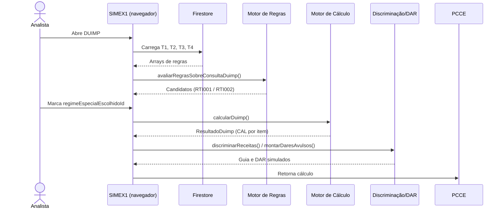
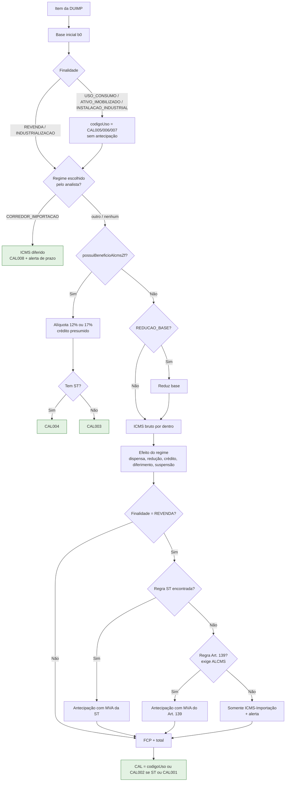
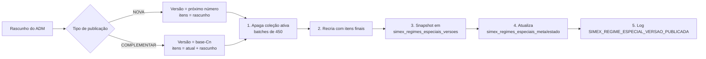
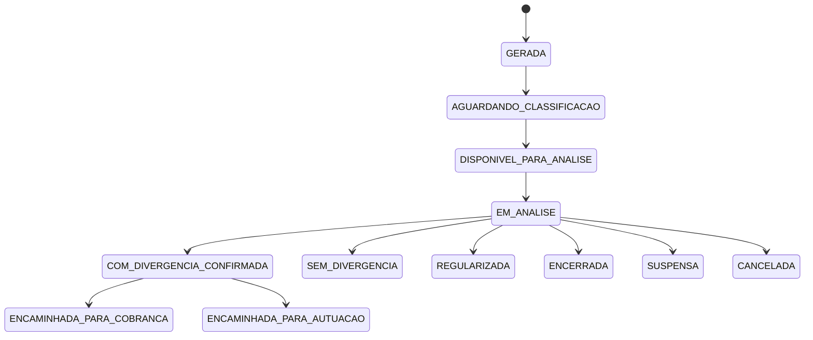
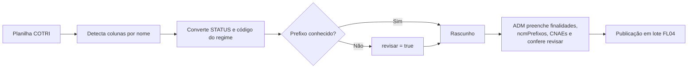
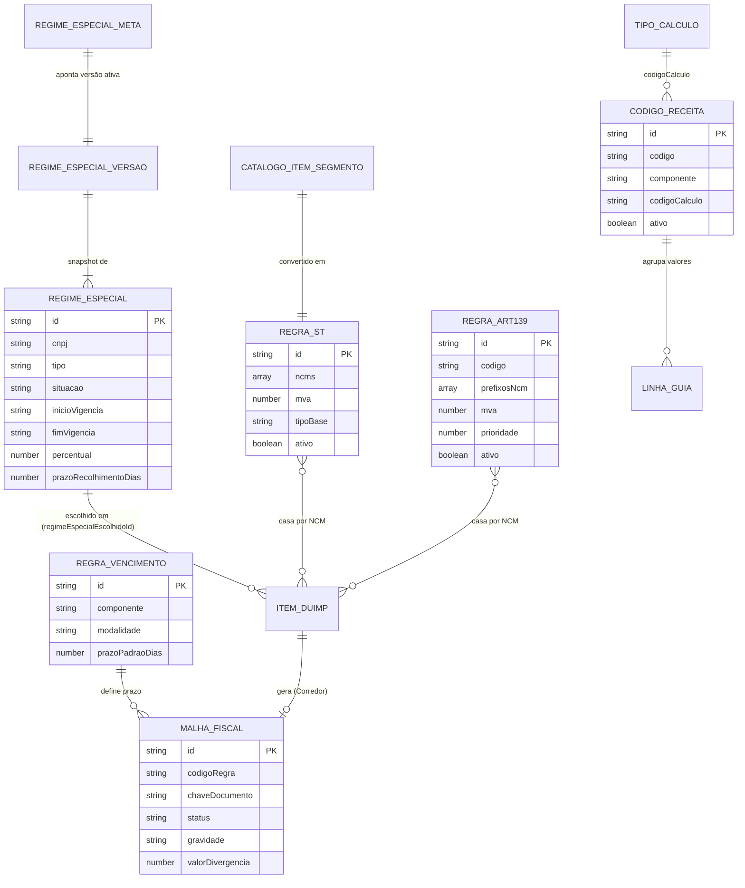

# Documento de Requisitos — SIMEX 1.0: Tabelas de Parâmetros e Motores de Cálculo

| Item | Valor |
| --- | --- |
| Sistema | Sentinel Gov · SIMEX 1.0 |
| Fonte | [SIMEX1 — Manual das Tabelas](https://claude.ai/artifact/2ShnfAwh9r7ENjhDMJoTpU) (versão de 11/09/2026) |
| Data deste documento | 22/10/2026 |
| Convenção | Itens marcados com **(inferido)** não estão explícitos na fonte e precisam de validação |

---

## 1. Descrição geral

### 1.1 Objetivo

O SIMEX 1.0 calcula o ICMS devido na importação (DUIMP), com os componentes ICMS-Importação, ICMS-ST, ICMS-Antecipação (Art. 139 RICMS/AP) e FCP. Ele também gera a discriminação da guia de recolhimento (DAR) e monitora o diferimento do Corredor de Importação por meio de malhas fiscais.

### 1.2 Premissa de arquitetura

- As regras fiscais são **parâmetros cadastráveis** no Firestore. Para incluir um regime, uma regra de ST ou uma alíquota nova, basta criar um documento na tabela certa, sem alterar código.
- Código novo só é necessário para criar uma **fórmula de cálculo nova** (um novo código CAL).
- Os motores de regras e de cálculo rodam **no navegador (client-side)**. Eles recebem as tabelas já carregadas por hooks React do Firestore.

### 1.3 Escopo

| Dentro do escopo | Fora do escopo (estado atual) |
| --- | --- |
| Cadastro das 4 tabelas principais (T1–T4) e das tabelas auxiliares | Transmissão do DAR ao SATE (o DAR é simulado) |
| Motor de Regras (candidatos a regime especial) | Motor de Alíquotas Internas (rascunho, não conectado ao cálculo) |
| Motor de Cálculo por item da DUIMP (CAL001–CAL008) | Malhas MAL-SIMEX-001 a 007, 009 e 010 (só catálogo) |
| Vencimento/prazo por componente | DIFAL consumidor final (regra inativa) |
| Malha do Corredor (MAL-SIMEX-008) | |
| Discriminação de receitas e DAR simulado | |
| Importação de dados por CSV/JSON e da planilha COTRI | |
| Painel de status dos motores | |
| Consulta NCM de elegibilidade ALCMS (protótipo) | |

### 1.4 Glossário

| Termo | Significado |
| --- | --- |
| DUIMP | Declaração Única de Importação |
| PAR / Regime Especial | Ato Declaratório concedido pela COTRI a um importador |
| COTRI | Órgão que emite os Atos Declaratórios |
| ALCMS/ZF | Área de Livre Comércio de Macapá e Santana / Zona Franca |
| ST | Substituição Tributária do ICMS |
| MVA | Margem de Valor Agregado (%) |
| CAL | Código do tipo de cálculo (CAL001–CAL008) |
| DAR | Documento de Arrecadação (guia de recolhimento) |
| GLME | Guia de Liberação de Mercadoria Estrangeira |
| FCP | Fundo de Combate à Pobreza |
| PCCE | Sistema que recebe o retorno do cálculo |
| EFD | Escrituração Fiscal Digital |
| Malha | Registro de monitoramento fiscal de uma possível divergência |

---

## 2. Atores

| Ator | Tipo | Responsabilidades |
| --- | --- | --- |
| ADM / Gestora | Humano | Publica regimes especiais em lote, cadastra regras ST, Art. 139, códigos de receita e regras de vencimento; liga e desliga motores; revisa importações COTRI |
| COTRI | Externo (humano/órgão) | Emite Atos Declaratórios e entrega a planilha oficial de atos |
| Analista fiscal | Humano | Analisa a DUIMP, vê os regimes candidatos e escolhe manualmente o regime de cada item |
| Auditor | Humano | Analisa e encerra malhas fiscais (ex.: MAL-SIMEX-008) |
| Contribuinte / Contador | Humano | Usa a Consulta NCM para verificar a elegibilidade ALCMS |
| Desenvolvedor | Humano | Mantém fórmulas de cálculo (CAL) e o manual |
| Firestore | Sistema | Armazena tabelas, versões, malhas e configurações |
| PCCE | Sistema | Recebe o resultado do cálculo; dispara a montagem da malha do Corredor |
| EFD | Sistema | Fonte das notas de saída consultadas pela malha do Corredor |
| SATE | Sistema | Destino futuro do DAR (integração não implementada) |

---

## 3. Requisitos funcionais

| ID | Descrição | Prioridade | Ator |
| --- | --- | --- | --- |
| RF001 | Carregar as tabelas T1–T4 do Firestore via hooks React antes de analisar uma DUIMP | Alta | Sistema |
| RF002 | Listar, para cada item da DUIMP, os regimes especiais candidatos (RN002) e retornar RTI001 (candidato encontrado) ou RTI002 (sem ato declaratório) | Alta | Analista |
| RF003 | Permitir que o analista escolha um regime candidato por item (`regimeEspecialEscolhidoId`) | Alta | Analista |
| RF004 | Calcular o ICMS de cada item seguindo a ordem oficial de decisão (RN003) e atribuir o código CAL | Alta | Sistema |
| RF005 | Buscar a regra ICMS-ST aplicável ao NCM do item | Alta | Sistema |
| RF006 | Buscar a regra Art. 139 aplicável por prioridade quando não houver ST | Alta | Sistema |
| RF007 | Discriminar os valores calculados por código de receita e montar a guia estadual simulada | Alta | Sistema |
| RF008 | Gerar um DAR avulso por código de receita, agrupado em IMPORTACAO, ANTECIPACAO ou OUTROS | Média | Sistema |
| RF009 | Resolver o vencimento (ENTRADA ou DIFERIDO) e o prazo em dias de cada componente | Alta | Sistema |
| RF010 | Montar a malha MAL-SIMEX-008 para itens com Corredor de Importação | Alta | Sistema / PCCE |
| RF011 | Classificar o prazo da malha do Corredor em DENTRO_DO_PRAZO, ALERTA ou VENCIDO | Alta | Sistema |
| RF012 | Consultar notas de saída na EFD para a malha do Corredor | Média | Sistema |
| RF013 | Permitir que o auditor evolua o status da malha e a encerre | Alta | Auditor |
| RF014 | Publicar regimes especiais em lote, com versão NOVA ou COMPLEMENTAR, snapshot e log | Alta | ADM |
| RF015 | Manter (criar, editar, remover) regras Art. 139 com log de auditoria | Alta | ADM |
| RF016 | Manter códigos de receita com log de auditoria | Alta | ADM |
| RF017 | Manter itens de segmento (fonte da ST) em Protocolos Ativos → Itens e convertê-los em regras ST na leitura | Alta | ADM |
| RF018 | Exibir as regras ST vigentes em "Tabelas Vigentes" | Média | ADM |
| RF019 | Manter regras de vencimento (`malhas_regras_vencimento_simex`) | Média | ADM |
| RF020 | Importar regimes especiais por CSV genérico (camelCase) | Média | ADM |
| RF021 | Importar a planilha oficial de Atos Declaratórios da COTRI e sinalizar registros a revisar | Alta | ADM |
| RF022 | Importar regras Art. 139 por JSON tolerante a nomes alternativos de campo | Média | ADM |
| RF023 | Ligar e desligar motores no painel de status (`simex_config/status_motores`) | Média | ADM |
| RF024 | Avaliar a elegibilidade ALCMS/ZF de um NCM na Consulta NCM | Baixa | Contribuinte |
| RF025 | Manter a tabela de alíquotas internas AP (rascunho, sem uso no cálculo) | Baixa | ADM |
| RF026 | Exibir o memorial de cálculo com fundamento legal, `origemMargem` e `margemPercentual` | Média | Analista |

## 4. Requisitos não funcionais

| ID | Categoria | Descrição |
| --- | --- | --- |
| RNF001 | Arquitetura | Os motores de regras e de cálculo rodam no navegador e recebem os arrays já carregados do Firestore, sem API própria |
| RNF002 | Manutenibilidade | Uma regra fiscal nova é cadastrada como documento, sem alterar código |
| RNF003 | Atualização | Alterações nas tabelas são vistas em tempo real pelos hooks e valem para a próxima análise |
| RNF004 | Auditoria | Toda criação, edição, remoção ou publicação gera log de auditoria |
| RNF005 | Rastreabilidade | A publicação de regimes especiais guarda um snapshot completo por versão |
| RNF006 | Desempenho | Gravações em lote são feitas em batches de 450 documentos |
| RNF007 | Segurança | A escrita em `simex_config/status_motores` e em regras de vencimento é restrita a ADM |
| RNF008 | Integridade | Malhas são append-only: um documento existente não é sobrescrito |
| RNF009 | Interoperabilidade | CSV com separador `;` e codificação Windows-1252/Latin-1 |
| RNF010 | Formato de dados | Datas no formato DD/MM/AAAA (a T3 cita também YYYY-MM-DD; ver seção 11) |

---

## 5. Regras de negócio

| ID | Regra | Relacionados |
| --- | --- | --- |
| RN001 | **Candidato não é aplicado.** O Motor de Regras só lista candidatos. O cálculo usa um regime apenas se o analista marcar `regimeEspecialEscolhidoId` no item. | RF002, RF003 |
| RN002 | **Filtros de candidato (todos em AND):** 1) `situacao = ATIVO`; 2) CNPJ igual, sem pontuação; 3) data ≥ `inicioVigencia`; 4) `fimVigencia` nulo ou data ≤ `fimVigencia`; 5) `finalidades` vazia ou contém a finalidade do item; 6) `ncmPrefixos` vazia ou o NCM começa com um prefixo; 7) `cnaesAutorizados` vazia, CNAE ausente ou CNAE na lista; 8) `modalidadeImportacao` ausente ou igual à do item. Lista vazia = sem restrição. | RF002 |
| RN003 | **Ordem oficial de decisão:** finalidade → Corredor de Importação → ALCMS/ZF → regime especial → ICMS-ST → Art. 139 → tipo de cálculo. | RF004 |
| RN004 | **Base inicial (b0)** = valor aduaneiro + II + IPI + PIS + COFINS + despesas aduaneiras + outros acréscimos (Art. 138, I, Lei 400/1997). | RF004 |
| RN005 | **Finalidade:** só REVENDA habilita antecipação (ST e Art. 139). USO_CONSUMO → CAL005; ATIVO_IMOBILIZADO → CAL006; INSTALACAO_INDUSTRIAL → CAL007. Esses códigos se sobrepõem a qualquer outro. INDUSTRIALIZACAO também não tem antecipação (correção de 25/08/2026). | RF004 |
| RN006 | **Corredor de Importação encerra o item:** ICMS diferido, `icmsImportacaoRecolher = 0`, status `ICMS_DIFERIDO`, código CAL008. As fases seguintes são ignoradas. | RF004, RF010 |
| RN007 | **Prazo do Corredor:** 1º `prazoRecolhimentoDias` do Ato; 2º `prazoPadraoDias` da regra de vencimento; 3º 60 dias (fallback fixo). | RF009, RF010 |
| RN008 | **Alerta da malha do Corredor** começa 10 dias antes do vencimento. | RF011 |
| RN009 | **ALCMS/ZF** (se `possuiBeneficioAlcmsZf = true`): alíquota de 17% para NCM 2202 (refrigerantes) e 3301/3302 (perfumaria/cosméticos); 12% nos demais (art. 142). Pode ser sobreposta por `aliquotaIcmsImportacaoAlcms` do item. Encerra com CAL003 (sem ST) ou CAL004 (com ST). | RF004 |
| RN010 | **Crédito presumido ALCMS:** 8% automático apenas quando a alíquota é 12%. Para 17%, crédito 0%, salvo `percentualCreditoPresumidoAlcms` informado no item (art. 137-A, §1º, Lei 2.217/2017). | RF004 |
| RN011 | **Base "por dentro":** baseIcms = baseTributável ÷ (1 − alíquota); icmsBruto = baseIcms × alíquota. | RF004 |
| RN012 | **Efeito do regime sobre o ICMS bruto:** DISPENSA_INTEGRAL → 0; REDUCAO_IMPOSTO → bruto × (1 − %); CREDITO_PRESUMIDO → desconta baseIcms × %; DIFERIMENTO → 0, status `ICMS_DIFERIDO` e alerta de prazo; SUSPENSAO → 0, status `SUSPENSO_SOB_CONDICAO`; REDUCAO_BASE → reduz a base antes do bruto. | RF004 |
| RN013 | **ST prevalece sobre Art. 139.** O Art. 139 só é buscado se a finalidade é REVENDA e nenhuma regra ST casou. | RF005, RF006 |
| RN014 | **Busca ST:** primeira regra com `ativo = true`, vigente e com NCM do item começando por um item de `ncms`. Não há ordenação. | RF005 |
| RN015 | **Busca Art. 139:** regras ativas, vigentes e com `prefixosNcm` vazio ou casando, ordenadas por `prioridade` crescente; vence a menor. 999 = regra geral. | RF006 |
| RN016 | **Art. 139 exige ALCMS.** Sem ALCMS/ZF o Art. 139 não se aplica: o motor registra alerta e recolhe só o ICMS-Importação. Com ST, a antecipação é calculada mesmo sem ALCMS. | RF006 |
| RN017 | **Código CAL sem ALCMS:** codigoUso, senão CAL002 (com ST), senão CAL001. **Com ALCMS:** codigoUso, senão CAL004 (com ST), senão CAL003. Corredor: sempre CAL008. | RF004 |
| RN018 | **FCP e total:** fcp = baseIcms × alíquota FCP; total = icms + antecipação + fcp. | RF004 |
| RN019 | **Discriminação:** para cada valor, busca o código de receita ativo com mesmo `componente` e `codigoCalculo` igual ao do item ou `"*"`. Valores com o mesmo código somam numa linha; sem código, vão para `semCodigo`. | RF007 |
| RN020 | **Grupos do DAR:** NORMAL → IMPORTACAO; ANTECIPACAO e ST → ANTECIPACAO; FCP → OUTROS. | RF008 |
| RN021 | **DAR simulado:** marcado `SIMULADO_NAO_TRANSMITIR`; número de controle, código de barras e linha digitável provisórios; `sate.vinculado = false`. | RF008 |
| RN022 | **Vencimento padrão:** NORMAL, ICMS_IMPORTACAO, ANTECIPACAO, ST e FCP → ENTRADA; CORREDOR_IMPORTACAO e ENCERRAMENTO_DIFERIMENTO → DIFERIDO (60 dias); DIFAL_CONSUMIDOR_FINAL → ENTRADA, inativo. | RF009 |
| RN023 | **Malha nasce** com código MAL-SIMEX-008, status GERADA, gravidade MEDIA, valorDeclarado 0 e valorDivergencia = valorCalculado. | RF010 |
| RN024 | **Malha append-only:** ID = chave única (`gerarChaveUnicaMalha`). Se existir, não sobrescreve status nem análise. O motor não persiste a malha: quem chama é responsável por gravar. | RF010 |
| RN025 | **Só o auditor encerra a malha.** O motor nunca decide o encerramento. | RF013 |
| RN026 | **Publicação de regimes:** sempre em lote versionado pelo painel, nunca edição avulsa nem pelo console do Firestore. NOVA = versão sequencial (01, 02…) que substitui tudo; COMPLEMENTAR = base + "-C" + contador (02-C1…), aplicada sobre a versão atual. | RF014 |
| RN027 | **Situação a partir do STATUS da COTRI:** VIGENTE → ATIVO; SUSPENSO → SUSPENSO; CANCELADO → CANCELADO; outros → VENCIDO. | RF021 |
| RN028 | **Tipo a partir do código do regime COTRI:** CP → CREDITO_PRESUMIDO; RBC → REDUCAO_BASE; PD → DIFERIMENTO; IS → DISPENSA_INTEGRAL; PF → SEM_REGIME_ESPECIAL; DH → DIFERIMENTO (revisar). DEC4098 → Corredor (percentual 8%); DEC1780 → Corredor (percentual 3%). Prefixos desconhecidos (MD, FL, ST, DH, IE…) recebem `revisar = true`. | RF021 |
| RN029 | **Campos não entregues pela COTRI** (`finalidades`, `ncmPrefixos`, `cnaesAutorizados`) chegam vazios e devem ser preenchidos pelo ADM antes de publicar. | RF021 |
| RN030 | **CSV genérico de regimes:** linha sem CNPJ é ignorada; listas separadas por vírgula; booleanos "sim"/"true"/"1" = true; números aceitam vírgula decimal; vazio = indefinido. | RF020 |
| RN031 | **JSON Art. 139:** aceita nomes alternativos; `prioridade` padrão 999; `ativo` padrão true ("S"/"Sim" = true); `vigenciaInicio` padrão = data da importação; `vigenciaFim` padrão null; prefixos aceitam array ou texto separado. | RF022 |
| RN032 | **Conversão de itens em regra ST:** NCMs extraídos do texto (separados por espaço, vírgula, `;` ou `/`), sem não-dígitos; descarta códigos com menos de 4 dígitos. MVA em fração é multiplicado por 100. Regra sempre ativa e sempre vigente. | RF017 |
| RN033 | **Elegibilidade ALCMS (Consulta NCM):** NCM fora da lista de vedados, CFOP diferente de amostra grátis e finalidade REVENDA ou INDUSTRIALIZACAO. Não afeta o cálculo da DUIMP, que usa o flag do item. | RF024 |
| RN034 | **Status dos motores:** desligar regrasSt, art139, vencimentoDifal, malhasSimex ou malhasDifal afeta o cálculo; desligar motorAliquotas, convenio5291, cfop ou cnae só muda a exibição. | RF023 |
| RN035 | **Registro inativo:** `ativo = false` (T2, T3, T4) ou `situacao ≠ ATIVO` (T1) faz o motor ignorar o registro. Use isso para desativar sem excluir. | RF001 |
| RN036 | **Regime inválido:** valor de `tipo` fora do enum faz o motor ignorar o regime. | RF002 |
| RN037 | **Modalidade obrigatória:** se o Ato exige modalidade e o item não informa, o regime não é candidato. | RF002 |

---

## 6. Fluxos

### 6.1 FL01 — Análise e cálculo de uma DUIMP

**Fluxo principal**

1. O analista abre uma DUIMP no SIMEX1.
2. O sistema carrega as tabelas T1–T4 (RF001).
3. O Motor de Regras lista os candidatos por item na aba "Motor de Regras" (RF002, RN002).
4. O analista escolhe o regime de cada item, se houver (RF003, RN001).
5. O Motor de Cálculo processa cada item conforme o FL02 (RF004).
6. O sistema discrimina as receitas e monta a guia simulada (RF007, RN019).
7. O sistema gera os DARs avulsos simulados (RF008, RN020, RN021).
8. O resultado volta ao PCCE. Se houver item com Corredor, segue o FL07.

**Fluxos alternativos**

- **A1 — Nenhum candidato:** o motor retorna RTI002 e o item é calculado sem regime especial.
- **A2 — Analista não escolhe regime:** o cálculo usa o tratamento padrão (RN001).

**Fluxos de exceção**

- **E1 — Valor sem código de receita:** o valor vai para `semCodigo` e a guia é gerada sem o código oficial (RN019).

### 6.2 FL02 — Cálculo de um item (Motor de Cálculo)

1. Calcula a base inicial b0 (RN004).
2. Define o código por finalidade (RN005).
3. Resolve o regime escolhido pelo analista (RN001).
4. Se o regime é Corredor: ICMS diferido, CAL008, fim (RN006).
5. Se o item tem ALCMS/ZF: alíquota do art. 142, crédito presumido, CAL003/CAL004, fim (RN009, RN010).
6. Se o regime é REDUCAO_BASE: reduz a base.
7. Calcula o ICMS bruto por dentro (RN011).
8. Aplica o efeito do regime (RN012).
9. Se a finalidade é REVENDA: busca ST; sem ST, busca Art. 139 (RN013–RN016).
10. Calcula FCP e total (RN018) e atribui o CAL (RN017).

> Nota: a fonte descreve o ramo ALCMS com "Fases 4–8 ignoradas", mas também atribui CAL004 quando há ST. O ponto em que a ST é avaliada no ramo ALCMS precisa ser confirmado (seção 11).

### 6.3 FL03 — Cadastrar novo Regime Especial (Ato Declaratório)

1. O ADM lê o Ato: CNPJ, tipo de benefício, NCMs, finalidade, vigência, exigência de GLME.
2. Escolhe o `tipo` (isenção total → DISPENSA_INTEGRAL; adiamento → DIFERIMENTO; redução de base → REDUCAO_BASE; crédito presumido → CREDITO_PRESUMIDO; suspensão → SUSPENSAO; corredor → CORREDOR_IMPORTACAO).
3. Monta o documento com os campos obrigatórios.
4. Publica pelo painel: Parâmetros → Regimes Especiais → publicar nova versão em lote (FL04).
5. Testa com uma DUIMP do mesmo CNPJ e um NCM da lista. O Ato deve aparecer na aba "Motor de Regras".
6. O analista aplica o regime manualmente quando pertinente.

**Exceção E1 — Ato não aparece como candidato:** revisar CNPJ, vigência, prefixos de NCM, situação, finalidade e modalidade (tabela de erros comuns na seção 7.1).

### 6.4 FL04 — Publicação versionada de Regimes Especiais

### 6.5 FL05 — Cadastrar nova regra ICMS-ST

1. O ADM identifica segmento, NCMs, MVA, tipo de base e protocolo na tabela oficial.
2. Cadastra o item em Protocolos Ativos → Itens (`simex_catalogo_itens_segmento`).
3. O sistema converte o item em regra ST na leitura (RN032) e o exibe em Tabelas Vigentes.
4. O ADM testa com uma DUIMP: `origemMargem` deve ser `ICMS_ST` e `margemPercentual` igual ao MVA.

**Exceção:** se `tipoBase = PAUTA`, `valorPauta` é obrigatório.

### 6.6 FL06 — Cadastrar regra Art. 139 / código de receita

**Art. 139:** definir NCMs, MVA e prioridade (específica < 999) → publicar → conferir que a prioridade é menor que a da regra geral.

**Código de receita:** identificar código SEFAZ e componente → definir `codigoCalculo` (`"*"` ou CAL específico) → publicar → gerar um DAR e verificar que o valor não caiu em `semCodigo`.

### 6.7 FL07 — Malha do Corredor de Importação (MAL-SIMEX-008)

1. Após o cálculo voltar ao PCCE, o sistema monta a malha (RN023) com o prazo resolvido (RN007).
2. O chamador grava a malha em `malhas_fiscais` (RN024).
3. O sistema classifica o prazo: DENTRO_DO_PRAZO, ALERTA (≤ 10 dias) ou VENCIDO (RN008).
4. O sistema consulta notas de saída na EFD.
5. O auditor analisa e evolui o status até o encerramento (RN025).

> A fonte diz que a progressão é "linear, mas não obrigatória". As transições acima seguem a ordem descrita; transições diretas entre outros estados **(inferido)** são permitidas.

### 6.8 FL08 — Importação de dados

| Origem | Destino | Formato | Regras |
| --- | --- | --- | --- |
| CSV genérico | T1 Regimes Especiais | CSV `;`, cabeçalho camelCase | RN030 |
| Planilha COTRI | T1 Regimes Especiais (rascunho) | CSV `;`, colunas em maiúsculas detectadas por nome | RN027–RN029 |
| JSON | T3 Art. 139 | Array de objetos | RN031 |
| Itens de segmento | T2 ICMS-ST (por conversão) | Cadastro no painel | RN032 |

---

## 7. Elementos de tela

> A fonte cita as telas mas não detalha o layout. Os tipos de componente abaixo são **(inferido)**; nomes de campo, valores e validações vêm da fonte.

### 7.1 TL01 — Parâmetros → Regimes Especiais (ADM)

| Campo | Tipo | Obrigatório | Validação / Máscara | Regra |
| --- | --- | --- | --- | --- |
| CNPJ | Texto | Sim | Aceita com ou sem pontuação; comparado só com dígitos | RN002 |
| Tipo | Select | Sim | Enum `TipoRegimeEspecial` | RN036 |
| Situação | Select | Sim | ATIVO, SUSPENSO, CANCELADO, REVOGADO, VENCIDO | RN035 |
| Início da vigência | Data | Sim | DD/MM/AAAA | RN002 |
| Fim da vigência | Data | Sim (aceita vazio = sem prazo) | DD/MM/AAAA ou null | RN002 |
| Finalidades | Multiseleção | Sim (aceita vazio) | REVENDA, INDUSTRIALIZACAO, USO_CONSUMO, ATIVO_IMOBILIZADO, INSTALACAO_INDUSTRIAL | RN002 |
| Prefixos de NCM | Lista de texto | Sim (aceita vazio) | Só dígitos | RN002 |
| CNAEs autorizados | Lista de texto | Sim (aceita vazio) | Código CNAE | RN002 |
| Modalidade de importação | Select | Não | CONTA_PROPRIA, CONTA_E_ORDEM, ENCOMENDA | RN037 |
| Ato Declaratório | Texto | Sim | Livre (ex.: AD-COTRI-042/2024) | — |
| Condições | Lista de texto | Sim | Livre; só exibição | — |
| Percentual | Número | Não | % (ex.: 4) | RN012 |
| Prazo de recolhimento (dias) | Número | Não | Inteiro > 0 | RN007 |
| Exige GLME | Checkbox | Não | — | — |
| Controla saldo | Checkbox | Não | Habilita tipoControleSaldo, saldoInicial, unidadeControle | — |
| Razão social | Texto | Não | Só exibição | — |
| Legislação | Texto longo | Não | Livre | — |
| Tipo de publicação | Radio | Sim | NOVA, COMPLEMENTAR | RN026 |
| Botão "Publicar nova versão" | Botão | — | Gera versão, snapshot e log | RN026 |

**Erros comuns a orientar na tela**

| Sintoma | Causa provável | Solução |
| --- | --- | --- |
| Regime nunca aparece como candidato | Situação ≠ ATIVO ou CNPJ diferente | Conferir situação e CNPJ |
| Aparece para importador errado | CNPJ digitado errado | Conferir CNPJ na DUIMP e no documento |
| Vencido e ainda aparece | `fimVigencia` futura ou nula | Atualizar fim e mudar situação para VENCIDO |
| Não aparece para um NCM | Prefixo longo ou errado | Testar prefixo mais curto |
| Aparece e não é aplicado | `regimeEspecialEscolhidoId` vazio | Analista precisa marcar |

### 7.2 TL02 — Upload de planilhas (CSV genérico e COTRI)

| Campo | Tipo | Obrigatório | Validação / Máscara | Regra |
| --- | --- | --- | --- | --- |
| Arquivo | Upload | Sim | CSV `;`, Windows-1252 | RNF009 |
| Formato | Detecção automática **(inferido)** | — | COTRI por nomes de coluna; genérico por camelCase | RN027–RN030 |
| Lista de registros importados | Tabela | — | Destaca `revisar = true` | RN028 |
| Aviso de campos vazios | Alerta | — | finalidades, ncmPrefixos, CNAEs | RN029 |

### 7.3 TL03 — Protocolos Ativos → Itens / Tabelas Vigentes (ICMS-ST)

| Campo | Tipo | Obrigatório | Validação / Máscara | Regra |
| --- | --- | --- | --- | --- |
| Segmento | Texto | Sim | Ex.: AUTO PEÇAS | — |
| Item | Texto | Sim | Ex.: "22" | — |
| NCM | Texto | Sim | Vários códigos separados; mínimo 4 dígitos | RN032 |
| CEST | Texto | Não | 00.000.00 | — |
| MVA | Número | Sim | % ou fração (normalizada) | RN032 |
| Tipo de base | Select | Sim | MVA, PAUTA, PMC | — |
| Valor de pauta | Moeda | Se PAUTA | R$ por unidade | — |
| Alíquota interna | Número | Não | % (informativo) | — |
| Fundamento legal | Texto | Sim | Livre | — |
| Tabelas Vigentes | Tabela (somente leitura) | — | Vitrine da conversão | RF018 |

### 7.4 TL04 — Regras Art. 139 (ADM)

| Campo | Tipo | Obrigatório | Validação / Máscara | Regra |
| --- | --- | --- | --- | --- |
| Código | Texto | Sim | Único na tabela | — |
| Descrição | Texto | Não | — | — |
| Prefixos de NCM | Lista de texto | Sim (aceita vazio = regra geral) | Só dígitos | RN015 |
| MVA | Número | Sim | % | — |
| Prioridade | Número | Sim | Menor vence; 999 = geral; evitar duplicata | RN015 |
| Ativo | Checkbox | Sim | — | RN035 |
| Vigência início / fim | Data | Sim | Fim null = sem prazo | RN015 |
| Fundamento legal | Texto | Sim | — | — |
| Importar JSON | Upload | — | Array de objetos | RN031 |

### 7.5 TL05 — Códigos de Receita (ADM)

| Campo | Tipo | Obrigatório | Validação / Máscara | Regra |
| --- | --- | --- | --- | --- |
| Código | Texto | Sim | Código SEFAZ/AP | RN019 |
| Descrição | Texto | Sim | Aparece na guia | — |
| Código de cálculo | Select | Sim | CAL001–CAL008 ou `*` | RN019 |
| Componente | Select | Sim | NORMAL, ST, ANTECIPACAO, FCP | RN019 |
| Ativo | Checkbox | Sim | — | RN035 |
| Vigência início / fim | Data | Não | Sem data = sempre vigente | — |

### 7.6 TL06 — Análise da DUIMP / aba "Motor de Regras" (Analista)

| Campo | Tipo | Obrigatório | Validação / Máscara | Regra |
| --- | --- | --- | --- | --- |
| Lista de itens (NCM, finalidade, modalidade, CNAE, ALCMS) | Tabela | — | Dados da DUIMP | RN002 |
| Candidatos por item | Lista | — | RTI001 / RTI002 | RF002 |
| Regime escolhido | Select por item | Não | Só candidatos do item | RN001 |
| Resultado do cálculo (CAL, base, ICMS, antecipação, FCP, total, status) | Tabela | — | — | RN017 |
| `origemMargem` / `margemPercentual` | Texto | — | Ex.: ICMS_ST / 71,78 | RF026 |
| Memorial de cálculo e alertas | Painel | — | Fundamento legal e alertas de prazo / Art. 139 | RN016 |

### 7.7 TL07 — Guia / DAR simulado

| Campo | Tipo | Obrigatório | Validação / Máscara | Regra |
| --- | --- | --- | --- | --- |
| Linhas por código de receita | Tabela | — | Soma por código | RN019 |
| Grupo | Texto | — | IMPORTACAO, ANTECIPACAO, OUTROS | RN020 |
| Valores sem código | Linha `semCodigo` | — | Destacar | RN019 |
| Número de controle, código de barras, linha digitável | Texto | — | Provisórios | RN021 |
| Marca "SIMULADO_NAO_TRANSMITIR" | Selo | — | Sempre visível | RN021 |

### 7.8 TL08 — Painel de status dos motores (ADM)

| Chave | Nome no painel | Tipo | Afeta cálculo? |
| --- | --- | --- | --- |
| regrasSt | Tabelas Vigentes — ICMS-ST | Toggle | Sim |
| art139 | Antecipação Importação — Art. 139 | Toggle | Sim |
| vencimentoDifal | Motor de Vencimento/Prazo — DIFAL | Toggle | Sim (prazo do Corredor) |
| malhasSimex | Motor de Malhas — SIMEX | Toggle | Sim (MAL-SIMEX-008) |
| malhasDifal | Motor de Malhas — DIFAL | Toggle | Sim |
| motorAliquotas | Motor de Alíquotas Internas — AP | Toggle | Não |
| convenio5291 | Convênio ICMS 52/91 — Anexos I e II | Toggle | Não |
| cfop | Tabela CFOP | Toggle | Não |
| cnae | Consulta CNAE | Toggle | Não |

### 7.9 TL09 — Malhas fiscais (Auditor)

| Campo | Tipo | Obrigatório | Validação / Máscara | Regra |
| --- | --- | --- | --- | --- |
| Código da regra, chave do documento, CNPJ | Texto | — | Somente leitura | RN023 |
| Data do fato gerador, prazo em dias | Data / número | — | — | RN007 |
| Situação do prazo | Badge | — | DENTRO_DO_PRAZO, ALERTA, VENCIDO | RN008 |
| Valores calculado, declarado, divergência | Moeda | — | — | RN023 |
| Notas de saída na EFD | Lista | — | Consulta EFD | RF012 |
| Status | Select | Sim | Enum StatusMalha | RN025 |
| Gravidade | Badge | — | INFORMATIVA a CRITICA | — |

### 7.10 TL10 — Consulta NCM (Contribuinte)

| Campo | Tipo | Obrigatório | Validação / Máscara | Regra |
| --- | --- | --- | --- | --- |
| NCM | Texto | Sim | Só dígitos | RN033 |
| CFOP é amostra grátis? | Checkbox | Não | — | RN033 |
| Finalidade | Select | Não | Enum de finalidades | RN033 |
| Resultado de elegibilidade | Mensagem | — | Elegível / não elegível e motivo **(inferido)** | RN033 |

---

## 8. Base de dados (Firestore)

### 8.1 T1 — `simex_regimes_especiais`

| Coluna | Tipo | PK/FK | Nulo | Descrição |
| --- | --- | --- | --- | --- |
| id | string | PK | Não | ID do documento; referenciado por `regimeEspecialEscolhidoId` |
| cnpj | string | — | Não | CNPJ do beneficiário |
| tipo | enum TipoRegimeEspecial | — | Não | CORREDOR_IMPORTACAO, DIFERIMENTO, REDUCAO_BASE, CREDITO_PRESUMIDO, SUSPENSAO, DISPENSA_INTEGRAL, REDUCAO_IMPOSTO, SEM_REGIME_ESPECIAL |
| situacao | enum | — | Não | ATIVO, SUSPENSO, CANCELADO, REVOGADO, VENCIDO |
| inicioVigencia | string (DD/MM/AAAA) | — | Não | Início da vigência |
| fimVigencia | string | — | Sim | Fim; null = sem prazo |
| finalidades | string[] | — | Não (pode ser vazio) | Finalidades abrangidas |
| ncmPrefixos | string[] | — | Não (pode ser vazio) | Prefixos de NCM |
| cnaesAutorizados | string[] | — | Não (pode ser vazio) | CNAEs autorizados |
| modalidadeImportacao | enum | — | Sim | CONTA_PROPRIA, CONTA_E_ORDEM, ENCOMENDA |
| atoDeclaratorio | string | — | Não | Número oficial do Ato |
| condicoes | string[] | — | Não | Condições (exibição) |
| percentual | number | — | Sim | Percentual do benefício |
| prazoRecolhimentoDias | number | — | Sim | Prazo do diferimento (Corredor) |
| exigeGlme | boolean | — | Sim | Exige GLME |
| controlaSaldo | boolean | — | Sim | Controle de saldo |
| tipoControleSaldo, saldoInicial, unidadeControle | diversos | — | Sim | Complemento do controle de saldo |
| razaoSocial, municipio, uf | string | — | Sim | Informativos |
| legislacao, observacoes, tipoBeneficioConcedido | string | — | Sim | Informativos |
| anoAto | number | — | Sim | Ano do Ato |
| dataPublicacao | string | — | Sim | Data de publicação |
| revisar | boolean | — | Sim | Marcação da importação COTRI |

### 8.2 T2 — `simex_regras_st` (derivada de `simex_catalogo_itens_segmento`)

| Coluna | Tipo | PK/FK | Nulo | Descrição |
| --- | --- | --- | --- | --- |
| id | string | PK | Não | ID da regra |
| segmento | string | — | Não | Segmento Nuseg |
| item | string | — | Não | Item na tabela oficial |
| descricao | string | — | Sim | Descrição do produto |
| ncms | string[] | — | Não | NCMs/prefixos (lista vazia nunca casa) |
| cest | string | — | Sim | Código CEST |
| mva | number | — | Não | MVA original (%) |
| tipoBase | enum | — | Não | MVA, PAUTA, PMC |
| valorPauta | number | — | Sim | Obrigatório se PAUTA |
| vigenciaInicio | string | — | Não | Início |
| vigenciaFim | string | — | Sim | Fim; null = sem prazo |
| ativo | boolean | — | Não | Regra ativa |
| protocolo | string | — | Sim | Protocolo/convênio |
| aliquotaInterna | number | — | Sim | Informativo |
| mvaAjustada | objeto {aliq4, aliq7, aliq12} | — | Sim | MVA ajustada por alíquota interestadual |
| fundamentoLegal | string | — | Não | Base legal |

### 8.3 T3 — `simex_regras_art139`

| Coluna | Tipo | PK/FK | Nulo | Descrição |
| --- | --- | --- | --- | --- |
| id | string | PK | Não | ID da regra |
| codigo | string | Único | Não | Ex.: ART139-COSMETICOS |
| descricao | string | — | Sim | Descrição |
| prefixosNcm | string[] | — | Não (vazio = geral) | Prefixos de NCM |
| mva | number | — | Não | Margem (%) |
| prioridade | number | — | Não | Menor vence; 999 = geral |
| ativo | boolean | — | Não | Regra ativa |
| vigenciaInicio | string | — | Não | Início |
| vigenciaFim | string | — | Sim | Fim; null = sem prazo |
| fundamentoLegal | string | — | Não | Base legal |

Registros padrão: ART139-A (prioridade 10, NCMs 2204–2208 e 2401–2403, MVA 50%), ART139-B (5, NCMs 2202/2203, MVA 140%), ART139-C (10, NCMs 3301/3302, MVA 30%), ART139-E (999, todos, MVA 15%).

### 8.4 T4 — `simex_codigos_receita`

| Coluna | Tipo | PK/FK | Nulo | Descrição |
| --- | --- | --- | --- | --- |
| id | string | PK | Não | Ex.: CR-1113 |
| codigo | string | — | Não | Código SEFAZ/AP |
| descricao | string | — | Não | Texto da guia |
| codigoCalculo | string | FK lógica → simex_tipos_calculo | Não | CALxxx ou `*` |
| componente | enum OrigemReceita | — | Não | NORMAL, ST, ANTECIPACAO, FCP |
| ativo | boolean | — | Não | Código ativo |
| vigenciaInicio | string | — | Sim | Início |
| vigenciaFim | string | — | Sim | Fim |

Registros iniciais: 1113 (NORMAL), 1828 (ANTECIPACAO), 1413 (ST), todos com `*` e vigência desde 01/01/2017. FCP e Corredor não têm registro inicial.

### 8.5 Coleções auxiliares

| Coleção | Campos principais | Uso |
| --- | --- | --- |
| `simex_tipos_calculo` | código (CAL001–CAL008), descrição | Referência de exibição |
| `malhas_regras_vencimento_simex` | id, componente, modalidade (ENTRADA/DIFERIDO), prazoPadraoDias, fundamentoLegal, descricao, ativo | Vencimento e prazo |
| `malhas_fiscais` | codigoRegra, tipoMalha, origemMalha[], chaveDocumento, cnpjContribuinte, dataFatoGerador, prazoDias, valorCalculado, valorDeclarado, valorDivergencia, gravidade, status | Malhas (compartilhada DIFAL e SIMEX) |
| `simex_alcms_excecoes_produtos` | NCMs vedados **(campos inferidos)** | Consulta NCM |
| `simex_motor_aliquotas` | regraGeral, aliquotasEspecificas, cestaBasicaIsenta, monofasicosAdRem | Rascunho |
| `simex_catalogo_itens_segmento` | segmento, item, cest, ncm (texto), mva, fundamentoLegal | Fonte da ST |
| `simex_config/status_motores` | chaves booleanas da seção 7.8 | Painel de status |
| `simex_regimes_especiais_versoes` | versao, tipo, publicadoEm, publicadoPor, quantidadeRegistros, itens[], resumoAlteracoes {incluidos, excluidos, alterados} | Snapshot por versão |
| `simex_regimes_especiais_meta/estado` | versaoAtivaBase, complementosDaBase | Controle de versão |

### 8.6 Diagrama de entidades

> `ITEM_DUIMP`, `LINHA_GUIA` e `TIPO_CALCULO` aparecem no diagrama para mostrar as relações; a fonte não detalha os campos da DUIMP.

---

## 9. Códigos de cálculo

| Código | Descrição |
| --- | --- |
| CAL001 | Importação sem ALCMS/ZF, sem ST |
| CAL002 | Importação sem ALCMS/ZF, com ICMS-ST |
| CAL003 | Importação com ALCMS/ZF, sem ST |
| CAL004 | Importação com ALCMS/ZF e ICMS-ST |
| CAL005 | Uso e consumo |
| CAL006 | Ativo imobilizado |
| CAL007 | Instalação industrial |
| CAL008 | Corredor de Importação, ICMS diferido integralmente |

## 10. Catálogo de malhas SIMEX

| Código | Nome | Situação |
| --- | --- | --- |
| MAL-SIMEX-001 | DUIMP liberada sem recolhimento | Só catálogo |
| MAL-SIMEX-002 | ICMS-Importação calculado a menor | Só catálogo |
| MAL-SIMEX-003 | ST/antecipação não calculada | Só catálogo |
| MAL-SIMEX-004 | GLME sem evento posterior | Só catálogo |
| MAL-SIMEX-005 | Mercadoria não escriturada na EFD | Só catálogo |
| MAL-SIMEX-006 | Nota de entrada não localizada | Só catálogo |
| MAL-SIMEX-007 | Saída incompatível com o regime especial | Só catálogo |
| MAL-SIMEX-008 | Prazo de diferimento vencido — Controle de Saída do Corredor | Implementada |
| MAL-SIMEX-009 | Estoque incompatível | Só catálogo |
| MAL-SIMEX-010 | Recolhimento não localizado | Só catálogo |

---

## 11. Pontos em aberto e premissas

- [ ] **Ordenação da ST:** `buscarSt` retorna a primeira regra encontrada, sem prioridade. Como desempatar quando dois itens de segmento casam com o mesmo NCM?
- [ ] **Percentual do Corredor:** o exemplo da T1 usa `percentual: 4` para o "Corredor 4%", mas a importação COTRI grava 8% para DEC4098 e 3% para DEC1780. Qual valor o cálculo deve usar?
- [ ] **ST no ramo ALCMS:** a Fase 3 diz que as fases 4–8 são ignoradas, mas o código atribuído é CAL004 quando há ST. Em que ponto a ST é avaliada e a antecipação calculada para itens ALCMS?
- [ ] **Formato de datas:** a T3 diz "YYYY-MM-DD", mas os exemplos usam DD/MM/AAAA. Qual é o padrão?
- [ ] **Filtros de candidato:** o manual fala em "7 filtros", mas o código lista 8 condições (vigência dividida em início e fim, mais CNAE). Confirmar a lista oficial.
- [ ] **Mapeamento PF → SEM_REGIME_ESPECIAL** e **DH → DIFERIMENTO (revisar)**: confirmar com a gestora.
- [ ] **Vigência dos itens ST:** a conversão grava as regras como sempre vigentes e ativas. A vigência deve ser controlada na coleção de itens?
- [ ] **Dados de exemplo:** o CNPJ da T1 (…/0001-32) difere do usado na malha (…000232).
- [ ] **Códigos de receita para FCP e Corredor:** pendentes de informação da gestora.
- [ ] **Tabela de alíquotas internas:** pendente de validação jurídica e homologação antes de ligar ao cálculo.
- [ ] **Integração SATE:** prazo e requisitos para transmitir o DAR real.
- [ ] **Malhas 001–007, 009 e 010:** priorização para implementação.
- [ ] **Telas:** layout e componentes não constam da fonte; os tipos de campo da seção 7 são inferidos.
